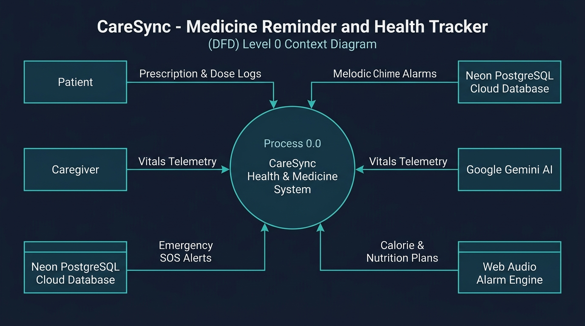
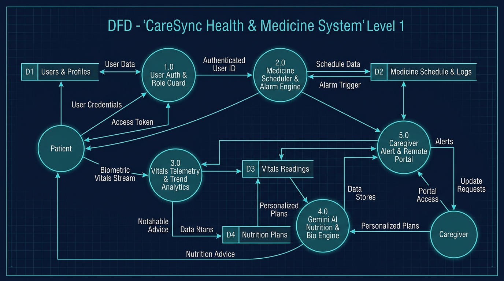
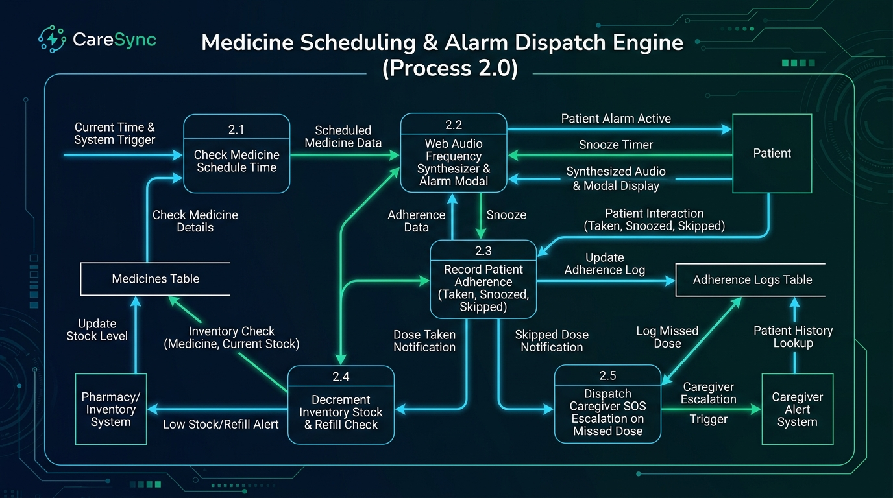

# CareSync — Data Flow Diagrams (DFD)

This document contains the visual Data Flow Diagrams (DFDs) for the **Medicine Reminder and Health Tracker (CareSync)** system, illustrating the flow of data between external entities, core application processes, and persistent data stores.

---

## 1. DFD Level 0 — Context Diagram

The Level 0 Context Diagram represents the entire CareSync system as a single central process (Process 0.0), showing all primary external entities interacting with the application.

### Entities and Data Inflows/Outflows:
- **Patient**:
  - *Inputs*: Enters prescription details, daily adherence confirmations (Taken, Snoozed, Skipped), vital sign telemetry (BP, glucose, weight, temp), and body questionnaire answers.
  - *Outputs*: Receives scheduled medication alarms (Web Audio chimes and modal visual prompts), clinical vitals status classifications, and personalized Gemini AI diet plans.
- **Caregiver**:
  - *Inputs*: Configures linked patient accounts, reviews alert notifications, and triggers emergency SOS chimes or simulated phone calls.
  - *Outputs*: Receives real-time missed dose alerts, abnormal blood pressure/sugar warnings, low pill stock notifications, and daily adherence rates.
- **Neon PostgreSQL Cloud Database**:
  - *Inflows*: Persistent storage of user accounts, linked caregiver-patient mappings, medicine inventories, dose logs, and vital telemetry.
  - *Outflows*: Relational query results, historical time-series analytics, and authentication hashes.
- **Google Gemini AI Service**:
  - *Inflows*: Patient biometrics (height, weight, age, activity level, conditions, allergies).
  - *Outflows*: Structured daily caloric targets, macronutrient splits, meal recommendations, and dietary caution notes.
- **Web Audio Alarm Engine**:
  - *Inflows*: Timer execution triggers from the application scheduler loop.
  - *Outflows*: Synthesized harmonic reminder chimes (`C5 -> E5 -> G5 -> C6`) directly to device speakers.

---

## 2. DFD Level 1 — System Process Decomposition

The Level 1 Diagram decomposes Process 0.0 into five primary subsystems, showing interactions with four normalized data stores.

### Sub-Processes:
1. **Process 1.0 — User Authentication & Role Guard**:
   - Manages user registrations, sessions, and cryptographic password hashing (`scryptSync`).
   - Routes users to either the Patient Portal or Caregiver Dashboard.
   - Interacts with **D1: Users & Profiles Data Store**.
2. **Process 2.0 — Medicine Scheduler & Alarm Engine**:
   - Compares current system time against scheduled dosage time slots (Morning, Afternoon, Evening, Bedtime).
   - Synthesizes audible chimes and renders interactive alarm confirmation dialogs.
   - Interacts with **D2: Medicine Schedule & Logs Data Store**.
3. **Process 3.0 — Vitals Telemetry & Trend Analytics**:
   - Validates and ingests physiological readings (BP, Glucose, Weight, BMI, Temperature).
   - Categorizes measurements against clinical benchmarks (AHA hypertension stages, diabetic fasting ranges).
   - Generates responsive Chart.js visual trend graphs and writes to **D3: Vitals Readings Data Store**.
4. **Process 4.0 — Gemini AI Nutrition & Bio-Chronology Engine**:
   - Analyzes patient body questionnaires and birth dates.
   - Python microservice calculates exact life spans, astrological/generational cohorts, and clinical screening guidelines.
   - Google Gemini AI computes personalized caloric blueprints and stores results in **D4: Nutrition Plans Data Store**.
5. **Process 5.0 — Caregiver Alert & Remote Portal**:
   - Polls active adherence telemetry and vitals thresholds.
   - Escalates missed doses and abnormal readings to off-site caregivers via real-time alerts and SOS banners.

---

## 3. DFD Level 2 — Medicine Scheduling & Alarm Dispatch Engine

The Level 2 Diagram details the inner data pipeline of **Process 2.0 (Medicine Scheduling & Alarm Dispatch Engine)**.

### Step-by-Step Flow:
- **2.1 Check Medicine Schedule Time**: Timer interval queries the `Medicines Table` for upcoming doses matching the active hour and minute.
- **2.2 Web Audio Frequency Synthesizer & Alarm Modal**: Upon timer match, triggers synthesized ascending tones (`523.25 Hz -> 659.25 Hz -> 783.99 Hz -> 1046.50 Hz`) and displays the pill visual representation with meal instructions.
- **2.3 Record Patient Adherence**: Captures patient response (`Taken`, `Snoozed 10m`, or `Skipped`) and logs the timestamped record in the `Adherence Logs Table`.
- **2.4 Decrement Inventory Stock & Refill Check**: When marked as `Taken`, automatically decrements available pill count. If remaining supply drops below 7 days, issues a low-stock alert to the Pharmacy Refill Hub.
- **2.5 Dispatch Caregiver SOS Escalation on Missed Dose**: If a dose remains unconfirmed past the grace window or is marked `Skipped`, immediately flags an urgent alert to the Caregiver Portal.

---

## Image File Inventory

All high-resolution diagram files are archived locally in the project repository under the `images/` directory:

| Diagram Level | Filename | Description | Resolution |
| :--- | :--- | :--- | :--- |
| **DFD Level 0** | [`images/dfd_level_0_context_diagram.jpg`](./images/dfd_level_0_context_diagram.jpg) | High-level Context Data Flow Diagram | 16:9 HD (1792x1024) |
| **DFD Level 1** | [`images/dfd_level_1_process_flow.jpg`](./images/dfd_level_1_process_flow.jpg) | Multi-Process Subsystem Data Flow Diagram | 16:9 HD (1792x1024) |
| **DFD Level 2** | [`images/dfd_level_2_medicine_engine.jpg`](./images/dfd_level_2_medicine_engine.jpg) | Detailed Medicine & Alarm Dispatch Pipeline | 16:9 HD (1792x1024) |
