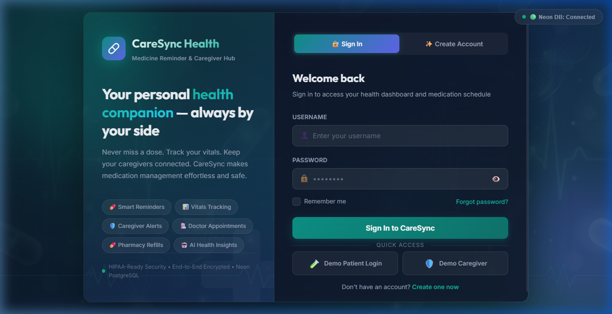
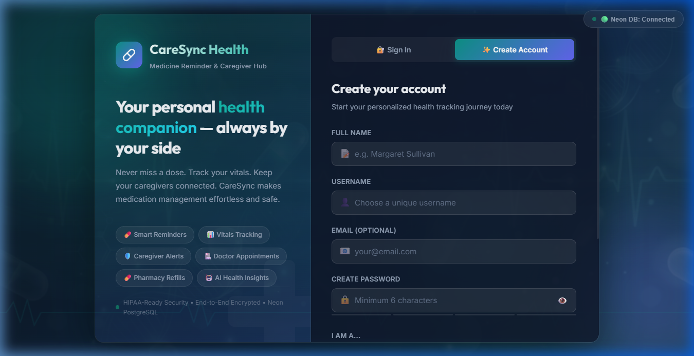
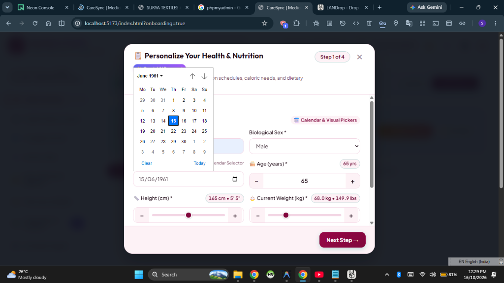
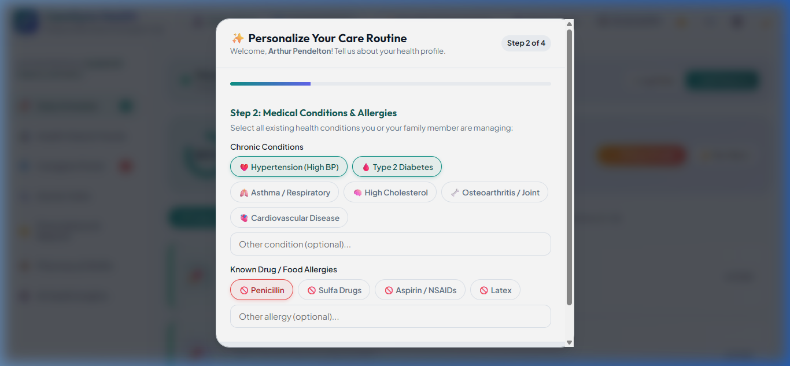
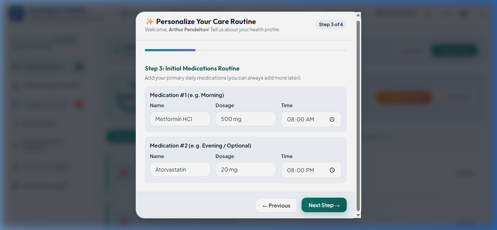
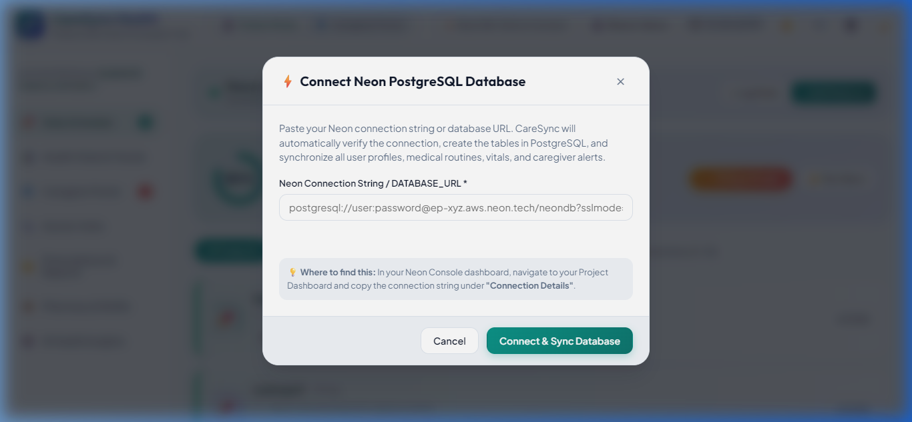
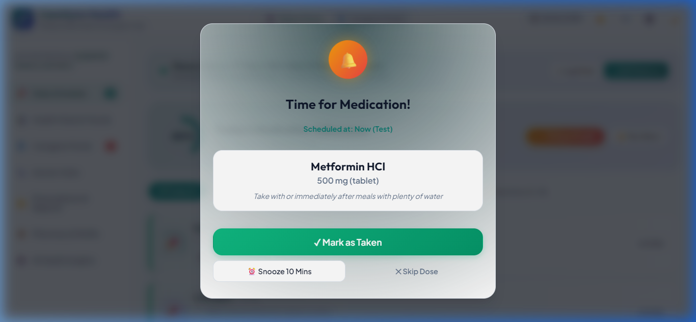

# CareSync — Input Design & Input Screen Specifications

This document catalogs the primary **Input Screens** designed and implemented in the **Medicine Reminder and Health Tracker (CareSync)** system. All screenshots are archived in the [`images/inputs/`](./images/inputs/) directory.

---

## 1. Input Screen 1: User Authentication & Login Portal

The entry point for patients and caregivers to securely authenticate and access their respective roles.

- **Input Fields**:
  - `Email Address` (`<input type="email">`): Validates format and matches registered account.
  - `Password` (`<input type="password">`): Secure input verified via `scryptSync` cryptographic hashing.
  - `Remember Me` checkbox: Preserves session token locally.
- **Actions**:
  - `Sign In to CareSync` (`btn-primary`): Submits credentials to `/api/auth/login`.
  - Tab Switcher: Seamlessly toggles to the Account Registration form.

---

## 2. Input Screen 2: Patient & Caregiver Account Registration

Allows new users to create an account, select their persona role, and initialize their health profile.

- **Input Fields**:
  - `Full Name` (`<input type="text">`): User's legal or preferred name.
  - `Email Address` (`<input type="email">`): Unique username / identifier.
  - `Account Password` (`<input type="password">`): Minimum 6 characters with secure masking.
  - `Confirm Password` (`<input type="password">`): Real-time client-side matching validation.
  - `Persona Role Selector`: Choose between **Patient** (self-management) and **Caregiver** (remote monitoring).
  - `Terms & Privacy Agreement` checkbox.
- **Actions**:
  - `Create CareSync Account` (`btn-primary`): Submits registration to `/api/auth/register`.

---

## 3. Input Screen 3: Body Biometrics & Date of Birth Picker (Step 1)

Captures fundamental physical biometrics required for accurate caloric expenditure and medication dosage safety.

- **Input Fields**:
  - `Full Name`: Patient display name.
  - `Biological Sex` dropdown: `Female`, `Male`, `Other`.
  - `Date of Birth Interactive Calendar`:
    - Fast decade pills (`1940s` to `2010s`).
    - Month dropdown (Jan–Dec) & Year dropdown (1920–present).
    - Interactive visual days grid with active day highlight.
    - Quick age presets (`65y`, `70y`, `50y`, `30y`).
  - `🎂 Age Stepper` (`<input type="number">`): Bidirectionally synced with the Date of Birth.
  - `📏 Height (cm)` dual range slider + numeric input (100 cm to 230 cm).
  - `⚖️ Current Weight (kg)` dual range slider + numeric input (30 kg to 200 kg).
- **Python Integration**: Live Bio-Chronology Engine calculates exact life span, zodiac, and clinical screening guidelines.

---

## 4. Input Screen 4: Physical Activity Level & Health Goals (Step 2)

Gathers lifestyle activity coefficients and primary health targets to calibrate daily energy requirements.

- **Input Fields**:
  - `Activity Level Cards` (Radio group):
    - *Sedentary*: Little or no daily exercise.
    - *Lightly Active*: Light exercise 1–3 days/week.
    - *Moderately Active*: Moderate exercise 3–5 days/week.
    - *Very Active*: Hard exercise 6–7 days/week.
  - `Primary Health Goal Cards` (Radio group):
    - *Maintenance*: Keep stable weight and blood sugar.
    - *Weight Loss*: Controlled caloric deficit.
    - *Chronic Disease Management*: Low sodium, heart-healthy balance.

---

## 5. Input Screen 5: Medical Conditions & Dietary Allergies (Step 3)

Captures existing chronic conditions and dietary restrictions to enable Gemini AI nutritional safety warnings.

- **Input Fields**:
  - `Chronic Conditions Chips` (Multi-select toggle):
    - *Hypertension*, *Type 2 Diabetes*, *High Cholesterol*, *Osteoporosis*, *Arthritis*, *Asthma*, *Thyroid Disorder*.
  - `Allergies & Sensitivities Chips` (Multi-select toggle):
    - *Gluten*, *Lactose / Dairy*, *Nuts / Peanuts*, *Shellfish*, *Eggs*, *Soy*, *Sodium Sensitive*.
  - `Dietary Preference Dropdown`: *Standard*, *Vegetarian*, *Vegan*, *Keto*, *Mediterranean*, *Low Sodium (DASH)*.

---

## 6. Input Screen 6: Neon PostgreSQL Database Connection Settings

Allows administrators and developers to configure cloud database connection strings and pooling parameters.

- **Input Fields**:
  - `Neon Database Connection URL` (`<input type="password">`): Accepts `postgresql://...` connection string.
  - `SSL Mode Toggle`: Enforces `sslmode=require` for cloud transactions.
  - `Test Connection` button: Runs immediate ping to verify credentials and table schemas.
- **Actions**:
  - `Save & Connect Database`: Stores verified credentials and switches backend from local store to Neon PostgreSQL.

---

## 7. Input Screen 7: Urgent Medication Reminder & Adherence Action Dialog

The real-time interactive modal triggered by the Web Audio scheduler when a dose is due.

- **Visual Indicators**: Pulsing alarm icon, medicine name, dosage, and food instructions.
- **Interactive Action Inputs**:
  - `✓ Mark as Taken` (`btn-success`): Logs dose as completed, triggers celebration confetti, and decrements stock.
  - `⏰ Snooze 10 Minutes` (`btn-warning`): Re-schedules audio alert and modal for 10 minutes later.
  - `✕ Skip Dose` (`btn-ghost`): Logs dose as skipped and notifies linked caregiver.

---

## Summary of Input Screen Artifacts

| Screen Number | Filename | Purpose | Category |
| :--- | :--- | :--- | :--- |
| **01** | [`input_01_user_login.png`](./images/inputs/input_01_user_login.png) | User authentication & credential submission | Security & Access |
| **02** | [`input_02_user_registration.png`](./images/inputs/input_02_user_registration.png) | Account creation & persona role selection | User Management |
| **03** | [`input_03_body_biometrics_and_dob.png`](./images/inputs/input_03_body_biometrics_and_dob.png) | Biometrics, Date of Birth calendar, age & height/weight | Health Questionnaire |
| **04** | [`input_04_activity_and_health_goals.png`](./images/inputs/input_04_activity_and_health_goals.png) | Physical activity & health goal selection | AI Nutrition Input |
| **05** | [`input_05_medical_conditions_and_allergies.png`](./images/inputs/input_05_medical_conditions_and_allergies.png) | Chronic conditions & dietary restrictions | Clinical Safety Input |
| **06** | [`input_06_database_config_settings.png`](./images/inputs/input_06_database_config_settings.png) | Cloud Neon PostgreSQL database connection string | System Configuration |
| **07** | [`input_07_medication_reminder_action.png`](./images/inputs/input_07_medication_reminder_action.png) | Dose confirmation action dialog (Taken, Snooze, Skip) | Medication Engine |
