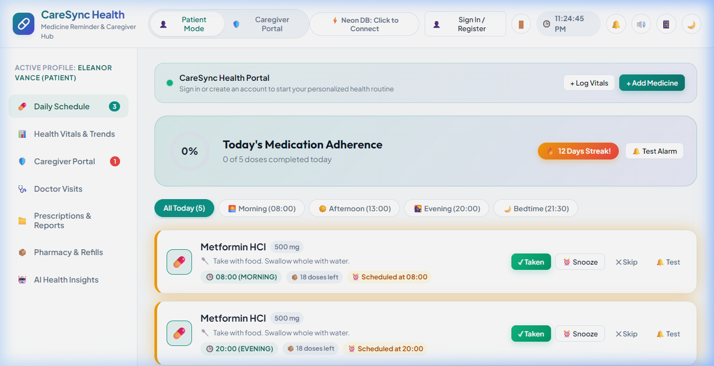
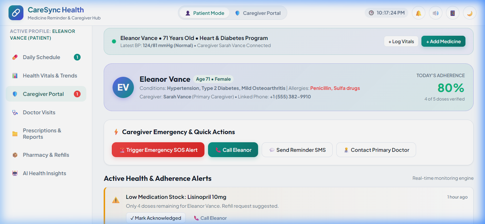
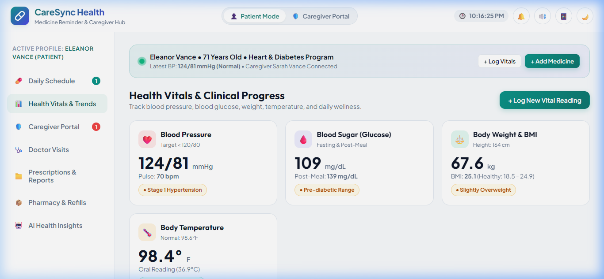
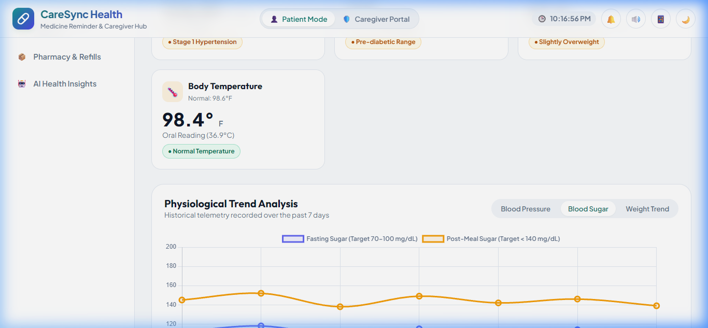
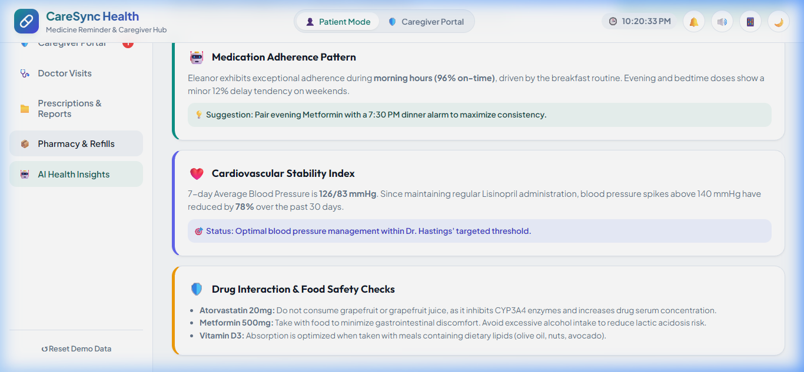
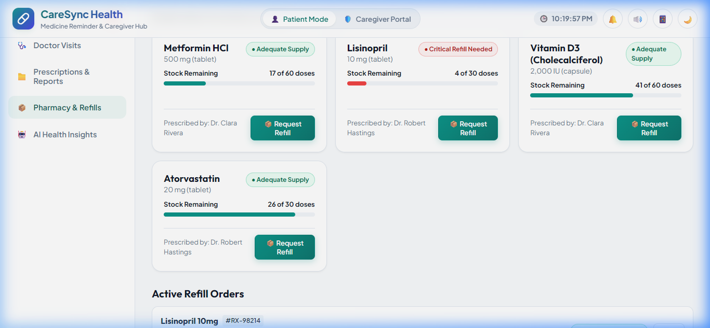
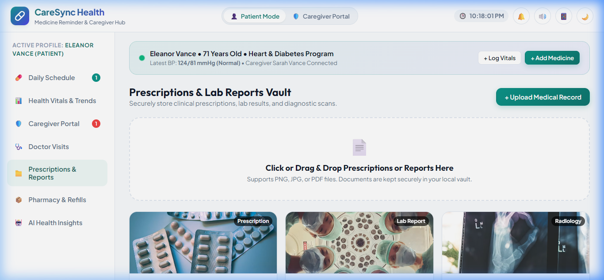
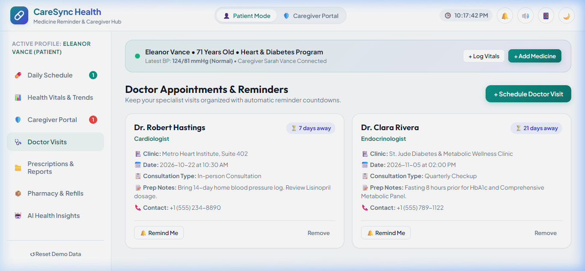

# CareSync — Output Design & Output Screen Specifications

This document catalogs the primary **Output Screens** designed and delivered by the **Medicine Reminder and Health Tracker (CareSync)** system. All screenshots are archived in the [`images/outputs/`](./images/outputs/) directory.

---

## 1. Output Screen 1: Patient Dashboard & Medication Adherence Schedule

The central dashboard delivering real-time medication schedules, daily adherence progress, and streaks.

- **Displayed Outputs**:
  - `Adherence Ring Indicator`: Circular progress gauge showing percentage of scheduled doses completed today.
  - `Daily Streak Counter`: Flame badge tracking consecutive days of 100% medication adherence.
  - `Time-Grouped Schedule Cards`: Morning, Afternoon, Evening, and Bedtime dose cards.
  - `Dose Status Flags`: Color-coded status badges (`✓ Taken` in green, `⏰ Due Now` with amber pulse, `✕ Missed` in red).
  - `Medication Details`: Dosage amount, pill shape/color icon, and relation to meals ("Take after breakfast with water").

---

## 2. Output Screen 2: Caregiver Remote Monitoring Portal & Alert Feed

Real-time oversight dashboard for family members and clinical caregivers to monitor patient safety remotely.

- **Displayed Outputs**:
  - `Patient Profile Header`: Monitored patient name, age, primary conditions, and verified daily adherence rate.
  - `Urgent Alert Feed`: Immediate chronologically ordered warning cards for missed doses, dangerously high/low vitals, and pill depletion.
  - `Emergency Action Triggers`: Simulated 1-click phone call trigger, instant reminder SMS dispatch, and urgent alarm broadcast.
  - `Safety Status Indicator`: Visual green/amber/red badge reflecting current physiological stability.

---

## 3. Output Screen 3: Clinical Health Vitals Telemetry Dashboard

Summary telemetry interface presenting categorized vital sign measurements against standard clinical thresholds.

- **Displayed Outputs**:
  - `Blood Pressure & Pulse`: Systolic/Diastolic reading with American Heart Association (AHA) stage classification (*Normal*, *Elevated*, *Stage 1*, *Stage 2 Hypertension*).
  - `Blood Sugar`: Glucose value (mg/dL) categorized by fasting state (*Normal*, *Prediabetic*, *Diabetic*).
  - `Weight & BMI`: Current body mass and auto-calculated BMI with World Health Organization (WHO) category chip.
  - `Body Temperature`: Reading in °F and °C with automated fever/hypothermia alerts.
  - `Wellness & Pain Score`: Visual slider status reflecting patient-reported energy and comfort.

---

## 4. Output Screen 4: Interactive Blood Glucose Trends Chart

Dynamic time-series visual analytics powered by Chart.js displaying glucose fluctuations over time.

- **Displayed Outputs**:
  - `Interactive Line Chart`: Smooth curved data plot mapping fasting vs post-prandial blood sugar over days/weeks.
  - `Safe Threshold Shading`: Target glycemic zone (70–130 mg/dL) highlighted with background fill.
  - `Data Point Tooltips`: Hover inspection revealing exact timestamps, meal relations, and nurse notes.
  - `Theme Adaptive Palette`: Automatic color contrast adjustments between Dark, Light, Rose, and Crimson themes.

---

## 5. Output Screen 5: Gemini AI Personalized Nutrition Blueprint

Tailored dietary plan synthesized by Google Gemini AI and the Python Bio-Chronology Engine.

- **Displayed Outputs**:
  - `Daily Caloric Budget`: Scientifically calculated Total Daily Energy Expenditure (TDEE) based on biometric inputs.
  - `Macronutrient Split`: Carbohydrates, proteins, and healthy fats breakdown customized to patient conditions (e.g. low-carb for diabetics, low-sodium for hypertension).
  - `AI Clinical Precautions`: Bulleted safety guidance highlighting potential food-drug interactions.
  - `Python Bio-Guidance`: Age-cohort preventive screening schedule (DEXA bone density, cardiac rhythm checks).

---

## 6. Output Screen 6: Pharmacy Inventory & Refill Fuel Gauges

Visual inventory tracking system forecasting medication supply depletion.

- **Displayed Outputs**:
  - `Medication Fuel Gauges`: Color-coded progress bars displaying remaining tablet count and estimated days of supply.
  - `Critical Refill Warning`: Warning badge when supply drops below the 7-day safety threshold.
  - `1-Click Refill Simulator`: Selection of preferred local pharmacy, supply duration (30/90 days), and delivery method.
  - `Order Tracker Stepper`: Multi-step progress tracker displaying order number, packaging status, and delivery ETA.

---

## 7. Output Screen 7: Digital Health Vault Document Archive

Repository of digitized medical records, prescriptions, and laboratory diagnostics.

- **Displayed Outputs**:
  - `Categorized Document Grid`: Prescription orders, blood test panels, imaging reports, and doctor clinical summaries.
  - `Document Metadata`: Upload timestamp, issuing physician name, file size, and specialty tags.
  - `Quick Actions`: Download, full-screen inspection, and doctor sharing links.

---

## 8. Output Screen 8: Fullscreen Document Inspection Preview Modal

High-resolution document reader for reviewing uploaded medical records and prescription details.

- **Displayed Outputs**:
  - `High-Fidelity Document Viewer`: Clear image/PDF rendering with pan and zoom capabilities.
  - `Clinical Notes Sidebar`: Transcribed prescription instructions, prescribed physician credentials, and date stamp.

---

## 9. Output Screen 9: Doctor Appointments & Specialist Consultation Schedule

Clinical calendar tracking upcoming doctor consultations and pre-visit clinical preparations.

- **Displayed Outputs**:
  - `Appointment Cards`: Specialist title (e.g. Cardiologist, Endocrinologist), clinic address, and consultation time.
  - `Countdown Badges`: High-visibility indicators (*"Tomorrow"*, *"In 3 Days"*).
  - `Preparation Instructions`: Fasting advisories, required health logs to bring, and reminder checklists.

---

## Summary of Output Screen Artifacts

| Screen Number | Filename | Purpose | Category |
| :--- | :--- | :--- | :--- |
| **01** | [`output_01_patient_dashboard.png`](./images/outputs/output_01_patient_dashboard.png) | Daily schedule, adherence ring & streaks | Patient Home |
| **02** | [`output_02_caregiver_portal.png`](./images/outputs/output_02_caregiver_portal.png) | Remote patient telemetry & urgent alert feed | Caregiver Oversight |
| **03** | [`output_03_vitals_telemetry_analytics.png`](./images/outputs/output_03_vitals_telemetry_analytics.png) | Vitals summary cards with clinical classifications | Clinical Telemetry |
| **04** | [`output_04_blood_glucose_trends_chart.png`](./images/outputs/output_04_blood_glucose_trends_chart.png) | Interactive Chart.js time-series blood sugar trends | Analytics & Reporting |
| **05** | [`output_05_gemini_ai_nutrition_plan.png`](./images/outputs/output_05_gemini_ai_nutrition_plan.png) | Caloric blueprint, macro splits & AI diet advice | Gemini AI Intelligence |
| **06** | [`output_06_pharmacy_refill_gauges.png`](./images/outputs/output_06_pharmacy_refill_gauges.png) | Pill stock fuel gauges & refill order tracker | Inventory Management |
| **07** | [`output_07_digital_health_vault.png`](./images/outputs/output_07_digital_health_vault.png) | Repository of prescriptions & lab reports | Medical Records |
| **08** | [`output_08_document_inspection_preview.png`](./images/outputs/output_08_document_inspection_preview.png) | Fullscreen viewer for diagnostic documents | Document Viewer |
| **09** | [`output_09_doctor_appointments_schedule.png`](./images/outputs/output_09_doctor_appointments_schedule.png) | Specialist consultations & pre-visit instructions | Clinical Calendar |
